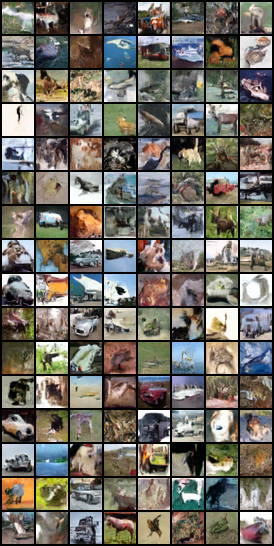
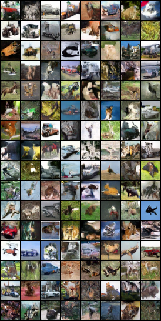
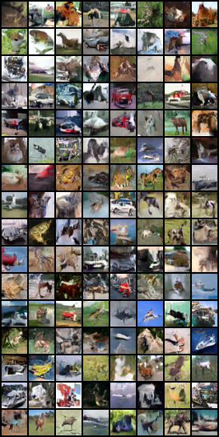
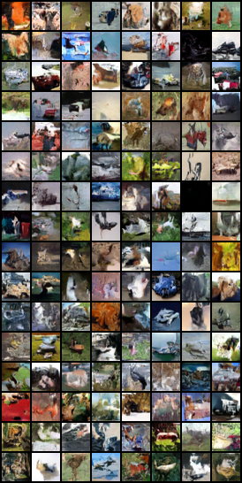
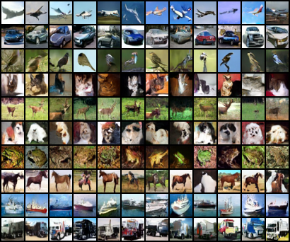

# diffusion-models

A from-scratch PyTorch implementation of diffusion models on CIFAR-10: discrete-time DDPM and DDIM, score-based SDEs, and rectified flow; and a masked diffusion language model on Tiny Shakespeare. The code follows the papers and their reference implementations; the aim is readability and checkable math, not production code or competitive FID.

- [Tuning](docs/tuning.md): how the baseline was found, and how noisy its score is.
- [Evaluation](docs/evaluation.md): the FID protocol, its calibration, and how to compare runs.
- [Architecture](docs/architecture.md): the models, forward processes and their samplers, the training loop, and the math the tests check.
- [Text](docs/text.md): the masked diffusion language model: its bound, its sampler, its evaluation, the release run, and why its gates start open.

## Scope

On CIFAR-10, this repo covers:

- three forward processes: discrete-time diffusion (linear and cosine schedules), score-based SDEs (VP, sub-VP and VE), and rectified flow
- their samplers: DDPM and DDIM; Euler–Maruyama, predictor–corrector and the probability-flow ODE; Euler on the flow
- UNet and DiT backbones
- EMA
- classifier-free guidance

The model has 770K parameters, about 2% of Ho et al.'s 35.7M, so that it trains on one consumer GPU or in Colab. The discrete, VP-SDE and flow results below train this same network on the same recipe. Sub-VP and VE are implemented and tested, not trained.

On Tiny Shakespeare, one token per character:

- a masked diffusion language model (MDLM): the masking forward process, its bound on the likelihood, and ancestral sampling
- an autoregressive baseline on the same transformer: not a diffusion model, but a reference for MDLM's bound. The code trains and scores it; it has no sampler, and no run of it is reported here

The text model has 16.6M parameters and trains in about 4 h on a T4.

## Results

### Discrete time, [`configs/image/ddpm.yaml`](configs/image/ddpm.yaml)

| Sampler | Steps | Model calls | FID | KID | Notes |
|---|---|---|---|---|---|
| DDPM | 1000 | 1000 | **35.77 ± 0.33** | **0.0257 ± 0.0003** | The baseline; mean ± std over seeds 0–4 |
| DDPM | 1000 | 1000 | 35.88 | 0.0260 | Seed 0; the reference for every row below |
| DDIM, $\eta = 0$ | 10 | 10 | 44.09 | 0.0385 | |
| DDIM, $\eta = 0$ | 20 | 20 | 38.75 | 0.0343 | |
| DDIM, $\eta = 0$ | 50 | 50 | 36.45 | 0.0294 | FID within noise of DDPM; KID's gap is 11 seed stds |
| DDIM, $\eta = 0$ | 100 | 100 | 35.84 | 0.0262 | Matches DDPM on both metrics |
| DDIM, $\eta = 0$ | 250 | 250 | 36.07 | 0.0238 | FID ties DDPM; KID ranks DDIM better |
| DDIM, $\eta = 1$ | 50 | 50 | 39.60 | 0.0377 | 3 FID behind $\eta = 0$ |
| DDIM, $\eta = 1$ | 100 | 100 | 35.93 | 0.0322 | Ties $\eta = 0$ on FID, not on KID |

### VP SDE, [`configs/image/vpsde.yaml`](configs/image/vpsde.yaml)

| Sampler | Steps | Model calls | FID | KID | Notes |
|---|---|---|---|---|---|
| Probability-flow ODE | 10 | 10 | 172.41 | 0.1812 | DDIM at 10 steps: 44.09 |
| Probability-flow ODE | 20 | 20 | 88.74 | 0.0804 | |
| Probability-flow ODE | 50 | 50 | 50.82 | 0.0383 | |
| Probability-flow ODE | 100 | 100 | 42.66 | 0.0301 | |
| Probability-flow ODE | 1000 | 1000 | **37.60** | **0.0262** | The best VP row: 1.7 FID behind DDPM, KID tied |
| Euler–Maruyama | 100 | 100 | 68.79 | 0.0579 | The SDE degrades far faster than the ODE |
| Euler–Maruyama | 1000 | 1000 | 39.15 | 0.0290 | 1.55 FID behind the ODE at the same calls |
| Predictor–corrector | 500 | 1000 | 39.27 | 0.0279 | Ties Euler–Maruyama at the same calls |

### Rectified flow, [`configs/image/flow.yaml`](configs/image/flow.yaml)

| Sampler | Steps | Model calls | FID | KID | Notes |
|---|---|---|---|---|---|
| Euler | 1 | 1 | 392.06 | 0.4382 | One step maps the noise to the predicted data mean |
| Euler | 2 | 2 | 198.30 | 0.2011 | |
| Euler | 5 | 5 | 67.63 | 0.0691 | |
| Euler | 10 | 10 | 48.68 | 0.0495 | The VP ODE at 10 steps: 172.41; DDIM: 44.09 |
| Euler | 20 | 20 | 42.29 | 0.0405 | |
| Euler | 50 | 50 | 38.97 | 0.0339 | |
| Euler | 100 | 100 | 37.97 | 0.0311 | FID within noise of 1000 steps, KID not; DDIM at 100: 35.84 |
| Euler | 1000 | 1000 | **37.34** | **0.0284** | The best flow row: 1.46 FID behind DDPM; ties the VP ODE on FID, not on KID |

### EMA against raw weights, [`configs/image/ddpm.yaml`](configs/image/ddpm.yaml)

DDIM, $\eta = 0$, 100 steps, on three checkpoints of one run. Checkpoint 199 is the last, the other tables' epoch 200.

| Checkpoint | EMA FID | EMA KID | Raw FID | Raw KID | Raw − EMA, FID |
|---|---|---|---|---|---|
| 190 | 35.83 | 0.0261 | 41.70 | 0.0305 | +5.87 |
| 195 | 35.58 | 0.0262 | 48.27 | 0.0360 | +12.69 |
| 199 | 35.67 | 0.0261 | 38.94 | 0.0281 | +3.27 |

EMA scores better at every checkpoint on both metrics. Its scores span 0.25 FID, under the seed std; the raw scores span 9.33, so a single raw checkpoint is not representative.

### UNet against DiT, [`configs/image/dit.yaml`](configs/image/dit.yaml)

DiT has 765K parameters to the UNet's 770K, on the recipe tuned for the UNet.

| Sampler | Steps | Model calls | UNet FID | UNet KID | DiT FID | DiT KID |
|---|---|---|---|---|---|---|
| DDIM, $\eta = 0$ | 10 | 10 | 44.09 | 0.0385 | 53.48 | 0.0500 |
| DDIM, $\eta = 0$ | 50 | 50 | 36.45 | 0.0294 | 45.45 | 0.0397 |
| DDIM, $\eta = 0$ | 100 | 100 | 35.67 | 0.0261 | 44.72 | 0.0374 |
| DDPM | 1000 | 1000 | 35.36 | 0.0255 | 46.24 | 0.0351 |

The UNet leads by 9–11 FID at every step count, and DiT takes 2.0× its time per model call. This compares the two on one recipe, not each at its best: DiT's was not tuned. Within DiT, FID ranks DDIM at 100 steps ahead of DDPM, and KID ranks them the other way.

### Classifier-free guidance, [`configs/image/ddpm.yaml`](configs/image/ddpm.yaml)

The same UNet with a class embedding (771K parameters), trained with `--omega 3 --run-name ddpm_cfg`. DDIM, $\eta = 0$, 100 steps, with two model calls per step at every $\omega$.

| $\omega$ | Steps | Model calls | FID | KID | Notes |
|---|---|---|---|---|---|
| No labels | 100 | 100 | 35.67 | 0.0261 | The unguided UNet, for reference |
| 0 | 100 | 200 | 39.65 | 0.0311 | The unconditional path alone |
| 1 | 100 | 200 | 32.38 | 0.0238 | The conditional path alone |
| 3 | 100 | 200 | **18.98** | **0.0064** | The best row of the sweep; the grid is coarse |
| 5 | 100 | 200 | 24.72 | 0.0065 | 5.74 FID behind $\omega = 3$; KID tied |

### Notes on the image tables

- **Protocol.** EMA weights at epoch 200 of each table's config, apart from the EMA table's raw weights and earlier checkpoints; 12,800 samples against all 50,000 training images. FID at this size is relative: it ranks runs in this repo, and does not compare with published numbers. For scale, two disjoint parts of the training set score 2.76, the test split 3.15, and pure noise 451 ([calibration](docs/evaluation.md#calibration)).
- **Noise.** Over sampling seeds, FID's std is 0.33 and KID's 0.0003, so a FID gap under about 0.7 is not a result.
- **Second GPU.** The EMA, DiT and guidance tables ran on another GPU, from the `v0.2.0` tag, with their UNet references scored there: DDIM at 100 steps 35.67, DDPM 35.36. The UNet's 10- and 50-step rows are the first table's.
- **In the first three tables, only the sampler differs within a table.** Across them the network and recipe are the same, but the forward process and the target differ, and so does the schedule: VP's $\beta$ is linear, the baseline's cosine. The hyperparameters were tuned on the discrete UNet only.
- **Cost** is model calls: predictor–corrector and guidance make two per step. Sampling time is proportional to them, plus a fixed cost for Inception features; DDPM's 1000 calls took 70–85 minutes on Colab, and 21 on the second GPU.
- **Data:** the baseline's five results files and the runs' [`compare_ddim.json`](results/compare_ddim.json), [`compare_vpsde.json`](results/compare_vpsde.json), [`compare_flow.json`](results/compare_flow.json), [`compare_published_check.json`](results/compare_published_check.json), [`compare_ema.json`](results/compare_ema.json), [`compare_dit.json`](results/compare_dit.json) and [`compare_cfg.json`](results/compare_cfg.json) are in [`results/`](results/).

### Text: masked diffusion on Tiny Shakespeare, [`configs/text/mdlm.yaml`](configs/text/mdlm.yaml)

| Model | Val loss per character | Notes |
|---|---|---|
| Uniform over the 65 characters | 4.174 | |
| Unigram: the character frequencies | 3.309 | |
| Bigram: given the previous character | 2.453 | |
| MDLM, `best.pt` (step 30,000) | **1.5718 ± 0.0196** | An upper bound on the NLL; ± is the standard error over validation sequences |
| nanoGPT's character-level transformer | 1.47 | Context only: an autoregressive model's exact NLL, not a bound |

MDLM's val loss is its NELBO per character on the whole validation set, with fixed masking noise ([evaluation](docs/text.md#evaluation)). One run, 30,000 steps in 4 h on a T4. Data: [`eval_results_mdlm.json`](results/eval_results_mdlm.json).

### Samples

Each image run's last training preview: EMA weights at epoch 200, 1000 steps of its config's sampler, from fixed noise.

| DDPM, [`ddpm.yaml`](configs/image/ddpm.yaml) | VP SDE, Euler–Maruyama, [`vpsde.yaml`](configs/image/vpsde.yaml) | Rectified flow, Euler, [`flow.yaml`](configs/image/flow.yaml) |
|---|---|---|
|  |  |  |

| DiT, DDPM, [`dit.yaml`](configs/image/dit.yaml) | Guidance, $\omega = 3$, one class per row, airplane to truck |
|---|---|
|  |  |

MDLM, ancestral sampling from `best.pt`, 256 steps, seed 0 (one of [four](results/samples_mdlm_256_steps.txt)):

```
make the land sprength in fire you frant on
But mean, Clifford, march your night of a sist.

KING DWAR  VI:
I sight nor ove that tumble an oath the ladge force!

KING RICHARD  III:
Expect, lean the went worthy third be not shall to joy!

BUCKINGHAM:
Such k
```

At [16 steps](results/samples_mdlm_16_steps.txt) the layout is preserved but most words are not: each step unmasks about sixteen characters, drawn independently ([sampler](docs/text.md#sampler)).

## Method

Every network, UNet or DiT, maps noisy images $x_t$, the time $t$ and optional class labels $y$ to a tensor of $x_t$'s shape. Discrete diffusion ($x_t = \sqrt{\bar\alpha_t}\, x_0 + \sqrt{1 - \bar\alpha_t}\, \varepsilon$) and the score SDE ($x_t = a(t)\, x_0 + s(t)\, \varepsilon$) train it to predict the noise $\varepsilon$, and rectified flow ($x_t = (1 - t)\, \varepsilon + t\, x_0$) to predict the velocity $x_0 - \varepsilon$, each with a squared error. A sampler starts from pure noise and applies the network on its own grid of times. [Architecture](docs/architecture.md) has the derivations and the figures.

The text model is a DiT over characters. Each character is masked with probability $t$, and the network maps the partly masked sequence and $t$ to logits for the clean character at every position. It trains on the cross-entropy at the masked positions, weighted by $1/t$: MDLM's bound on the negative log-likelihood. Its sampler starts from all masks and, from $t$ to $s$, unmasks each remaining mask with probability $(t - s)/t$. [Text](docs/text.md) has the equations.

## Usage

Install from `requirements.txt`, or use Docker, with the repo mounted at `/source` and a data folder at `/data`:

```bash
docker build -t diffusion-models .
docker run --gpus all --ipc=host --ulimit memlock=-1 --ulimit stack=67108864 -it --rm -v $PWD:/source -v <path_to_data_folder>:/data diffusion-models
```

Every entry point writes its artifacts under `--root`; the commands below use `/data`.

- **Tests:** `pytest`, on a CPU, in seconds.
- **Figures:** `make figures` redraws `docs/figures/` from the tests.

The commands behind the results tables, apart from the seed-0 rows, which come from one `ddpm.image.compare` run per table ([evaluation](docs/evaluation.md#the-readmes-runs)):

```bash
# Train the five checkpoints
python -m ddpm.image.train -c configs/image/ddpm.yaml --root /data
python -m ddpm.image.train -c configs/image/vpsde.yaml --root /data
python -m ddpm.image.train -c configs/image/flow.yaml --root /data
python -m ddpm.image.train -c configs/image/dit.yaml --root /data
python -m ddpm.image.train -c configs/image/ddpm.yaml --root /data --omega 3 --run-name ddpm_cfg

# Build the memorisation check's feature bank, once, before any eval
python -m scripts.precompute_features -c configs/image/ddpm.yaml --root /data

# The baseline row: seeds 0-4
python -m ddpm.image.eval -c configs/image/ddpm.yaml --root /data --seeds 0-4

# The FID scale
python -m scripts.calibrate_fid -c configs/image/ddpm.yaml --root /data

# Text: train MDLM, score best.pt, and sample at 256 and 16 steps
python -m ddpm.text.train -c configs/text/mdlm.yaml --root /data
python -m ddpm.text.eval -c configs/text/mdlm.yaml --root /data
python -m ddpm.text.generate -c configs/text/mdlm.yaml --root /data
python -m ddpm.text.generate -c configs/text/mdlm.yaml --root /data --num-steps 16
```

Image training writes a preview grid to `<root>/plots/<run_name>/` at every checkpoint; the grids above are the last ones. The text entry points download Tiny Shakespeare under `--root` on first use.

## What's next

- **Text, towards LLaDA (Nie et al. 2025):** confidence-based and semi-autoregressive sampling, a model without the time input, and prompted generation.

## Papers

- Ho et al. 2020 (DDPM): training, ancestral sampling, the linear schedule.
- Song, Meng & Ermon 2021 (DDIM): the sampler.
- Song et al. 2021 (score SDE): the VP, sub-VP and VE SDEs, Euler–Maruyama, predictor–corrector and the probability-flow ODE.
- Liu et al. 2023 (rectified flow) and Lipman et al. 2023 (flow matching): the straight path and its velocity objective.
- Nichol & Dhariwal 2021: the cosine schedule.
- Ho & Salimans 2022: classifier-free guidance.
- Peebles & Xie 2023 (DiT): the transformer backbone and adaLN-Zero.
- Saharia et al. 2022: static thresholding.
- Heusel et al. 2017 (FID) and Bińkowski et al. 2018 (KID).
- Austin et al. 2021 (D3PM): discrete diffusion, and masking as an absorbing state.
- Sahoo et al. 2024 (MDLM): the masked diffusion bound, its SUBS parameterisation, and ancestral sampling.
- Shi et al. 2024 (MD4): the bound's independence of the masking schedule.
- Ou et al. 2024 (RADD) and Zheng et al. 2024: why the time input is optional; Zheng et al. also on float32 rounding in categorical sampling.
- Kingma et al. 2021 (VDM): the low-discrepancy sampler of training times.
- Tancik et al. 2020: Fourier features, for the text model's time input.
- Karpathy's char-rnn (the Tiny Shakespeare corpus) and nanoGPT (its split, and the 1.47 reference).

## License

MIT
