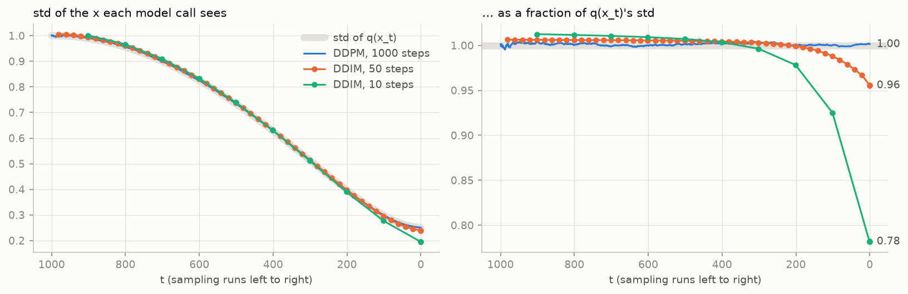
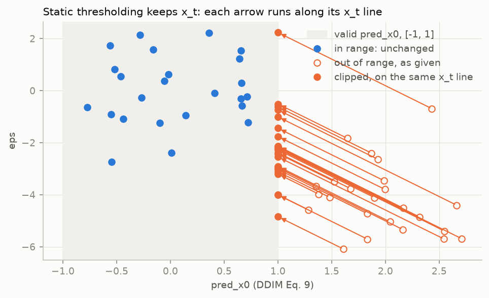
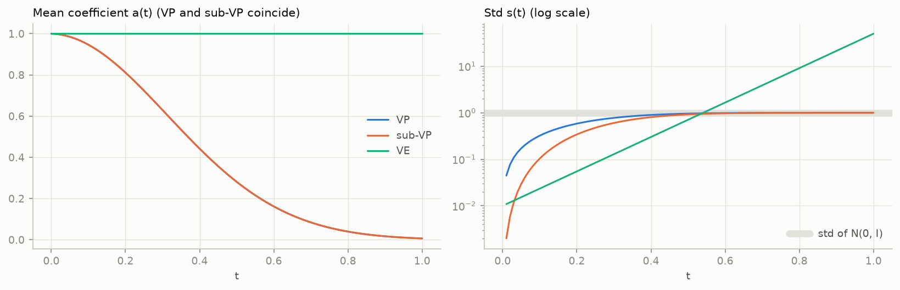
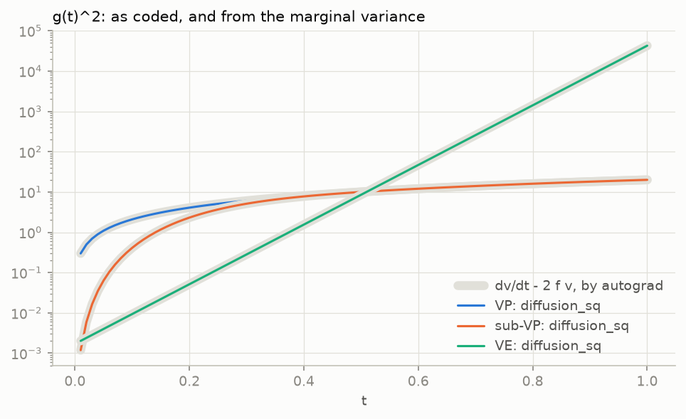
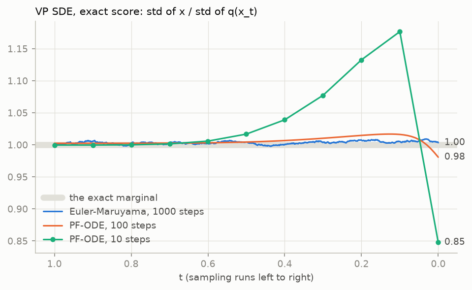
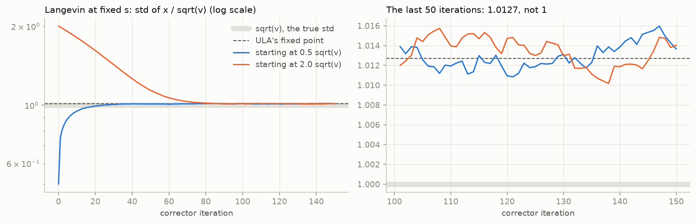
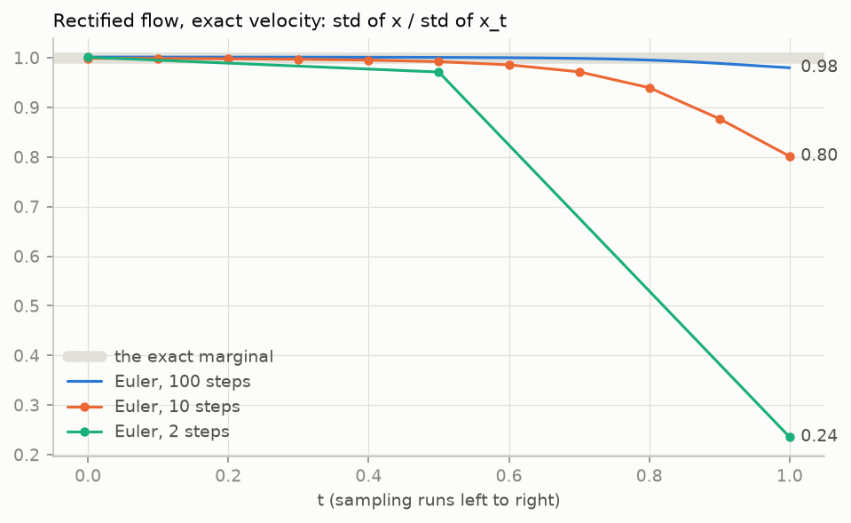

# Architecture

This page covers the models, the three forward processes and their samplers, the training loop, and the math the tests check, with the derivations behind them.

## The denoiser contract

Every model is one function,

$$\varepsilon_\theta(x_t, t, y) \;\to\; \hat\varepsilon,$$

which takes a batch $x_t$ of shape (B, C, H, W) in $[-1, 1]$ and returns a tensor of the same shape: the predicted noise for the diffusion models, the predicted velocity $\hat v$ for rectified flow. $y$ is a class label, the null class (index `num_classes`), or `None`. What $t$ is depends on the forward process:

| Forward process | Schedules | $t$ | From data to noise as $t$ | Network predicts |
|---|---|---|---|---|
| Discrete | linear, cosine | long in $[0, T)$; index $i$ is the paper's $t = i + 1$ | grows | $\varepsilon$ |
| Score SDE | VP, sub-VP, VE | float32 in $(0, 1]$ | grows | $\varepsilon$ |
| Rectified flow | — | float32 in $[0, 1]$ | falls: noise at $t = 0$, data at $t = 1$ | $v = x_0 - \varepsilon$ |

The samplers see the model only through `predict_noise` in `ddpm/image/diffusion/base.py`. That is also where classifier-free guidance happens, by Ho & Salimans' Eq. 6 with $\omega = 1 + w$, on $\hat v$ as on $\hat\varepsilon$:

$$\hat\varepsilon = \varepsilon_\theta(x_t, t, \varnothing) + \omega \left(\varepsilon_\theta(x_t, t, y) - \varepsilon_\theta(x_t, t, \varnothing)\right).$$

## Models

| | UNet ([`configs/image/ddpm.yaml`](../configs/image/ddpm.yaml)) | DiT ([`configs/image/dit.yaml`](../configs/image/dit.yaml)) |
|---|---|---|
| Parameters | 770K | 765K |
| Representation | Feature maps at $32^2$, $16^2$, $8^2$, $4^2$ | 256 tokens, one per $2 \times 2$ patch |
| Width | 32 / 64 / 64 / 64 channels | 64 |
| Depth | 2 residual blocks per stage, down and up, and a bottleneck | 10 transformer blocks |
| Attention | At $16^2$ and in the bottleneck, 2 heads | Every block, 2 heads |
| Conditioning | Scale and shift of every residual block's GroupNorm | adaLN-Zero in every block |
| Position | Implicit in the convolutions | Fixed 2D sin-cos embedding |

Both embed $t$ the same way: the sinusoidal encoding of Ho et al.'s Appendix B, of the index for discrete schedules and of $999\,t$ for continuous ones, as the score SDE and rectified-flow reference code do, then Linear → SiLU → Linear to a 64-d vector. With guidance on, a learned class embedding with `num_classes + 1` rows, the last one the null class, is added to it.

**UNet** (Ho et al., Appendix B). Deviations:
- A residual block is one convolution, then GroupNorm, a scale and shift from the timestep embedding (AdaGN, Dhariwal & Nichol §3.1), and SiLU, plus a shortcut. DDPM's block has two pre-activation convolutions, and adds the embedding as a bias between them.
- No GroupNorm before attention.
- Downsampling is a $1 \times 1$ stride-2 convolution, upsampling a transposed convolution. DDPM uses a $3 \times 3$ stride-2 convolution, and nearest-neighbour upsampling followed by a $3 \times 3$ convolution.
- One skip connection per stage rather than per block, $1 \times 1$ stem and head convolutions, and a skip from the stem into the head.

**DiT** (Peebles & Xie). The image is cut into $2 \times 2$ patches, each linearly embedded as a token. Each block is attention and an MLP, each gated by adaLN-Zero on the timestep (and class) embedding. A final adaLN layer maps each token back to a $2 \times 2 \times 3$ patch. Deviations: pixel space instead of VAE latents, and only $\varepsilon$ is predicted, not the variance.

## Training

Each step draws $\varepsilon \sim \mathcal N(0, I)$ and a time $t$, forms $x_t$ from a clean image $x_0$, and regresses the network's output onto a target with a squared error:

| Forward process | $t$ | $x_t$ | Target |
|---|---|---|---|
| Discrete (Ho et al., Alg. 1) | uniform on $\{1, \dots, T\}$ | $\sqrt{\bar\alpha_t}\, x_0 + \sqrt{1 - \bar\alpha_t}\, \varepsilon$ (Eq. 4) | $\varepsilon$: $L_\text{simple}$ (Eq. 14) |
| Score SDE | uniform on $[10^{-5}, 1)$ | $a(t)\, x_0 + s(t)\, \varepsilon$ (score SDE Eq. 29) | $\varepsilon$: denoising score matching (Eq. 7) with $\lambda(t) = s(t)^2$, since the score of $x_t$ given $x_0$ is $-\varepsilon / s(t)$ |
| Rectified flow | uniform on $[0, 1)$ | $(1 - t)\, \varepsilon + t\, x_0$ | $x_0 - \varepsilon$ (Liu et al., Eq. 1) |

All three use one recipe, tuned on the discrete model: Adam at a constant learning rate of $10^{-3}$, gradient-norm clipping at 1.0, random horizontal flips, 200 epochs.

- **EMA.** After each step, $\theta_\text{EMA} \leftarrow \lambda\, \theta_\text{EMA} + (1 - \lambda)\, \theta$ with $\lambda = 0.999$, over the trainable parameters. Evaluation uses the EMA weights.
- **Classifier-free guidance.** Training drops each label to the null class with probability 0.1 (Ho & Salimans, Alg. 1).
- **Validation loss.** Every 5 epochs, the training loss on the test split, for both the raw and the EMA weights, with a fixed $(t, \varepsilon)$ drawn from its own RNG, so it does not perturb training. It is not comparable across forward processes: flow's target $x_0 - \varepsilon$ has variance $1 + \mathrm{Var}(x_0)$, not 1.
- **Loss per timestep range.** The training loss is also logged per tenth of the time range. Its mean is not comparable across schedules, but these ten curves reveal a schedule that spends most training steps on near-pure noise ([tuning](tuning.md#appendix-before-the-ladder)).

## Samplers

Every sampler starts from $\mathcal N(0, I)$ noise, maps it onto its forward process's prior (only VE rescales it, to $\mathcal N(0, \sigma_\text{max}^2 I)$), and calls the model once per step on its own grid of times:

| Forward process | Sampler | Step | Model calls |
|---|---|---|---|
| Discrete | DDPM (Ho et al., Alg. 2) | the posterior mean (Eq. 11), plus noise of variance $\beta_t$ | $T$ |
| Discrete | DDIM (Song, Meng & Ermon, Eq. 12) | deterministic at $\eta = 0$ | $N$, a divisor of $T$ |
| Score SDE | Euler–Maruyama | the reverse-time SDE, score SDE Eq. 6 | $N$ |
| Score SDE | Probability-flow ODE | Eq. 13: Eq. 6's drift with half the score term, and no noise | $N$ |
| Score SDE | Predictor–corrector (App. G) | an Euler–Maruyama step, then a Langevin step at the new time | $2N$ |
| Rectified flow | Euler | $x \leftarrow x + \Delta t\, \hat v$, with $t$ rising from 0 to 1 | $N$ |

For a forward SDE $dx = f(x, t)\, dt + g(t)\, dw$ (score SDE Eq. 5), the reverse-time SDE

$$dx = \left[f(x, t) - g(t)^2\, \nabla_x \log p_t(x)\right] dt + g(t)\, d\bar w \qquad \text{(Eq. 6)}$$

and the probability-flow ODE

$$dx = \left[f(x, t) - \tfrac12\, g(t)^2\, \nabla_x \log p_t(x)\right] dt \qquad \text{(Eq. 13)}$$

share its marginals $p_t$. The network supplies the score as $\nabla_x \log p_t \approx -\hat\varepsilon / s(t)$. The SDE samplers walk $N + 1$ times spaced evenly from 1 down to $10^{-4}$ (the reference code stops at $10^{-3}$ for VP), and the last step adds no noise. The VP samplers run on VP and sub-VP alike: each reads its $g(t)^2$ from the schedule.

## Tests and math

The tests check the repo's own math and its asymptotics, not library behaviour. `pytest` runs in seconds on a CPU. `pytest --viz` makes each test also draw what it checks, and `make figures` copies the drawings into `docs/figures/`, so the figures cannot diverge from the code.

### Schedules run from data to noise

**Claim.** For the linear and cosine schedules at $T = 1000$, every $\beta_t \in (0, 1)$, so

$$\bar\alpha_t = \prod_{s=1}^{t} (1 - \beta_s)$$

falls strictly, from $\bar\alpha_1 \approx 1$ to $\bar\alpha_T \approx 0$. Then $x_T$ keeps under 1% of $x_0$, and $q(x_T) \approx \mathcal N(0, I)$.

**Test.** Checks each of these bounds for both schedules.

**Figure.** $\beta_t$, the noise added per step; $\bar\alpha_t$, the signal kept, with a dot where it halves; and the log signal-to-noise ratio $\log \bar\alpha_t / (1 - \bar\alpha_t)$. Cosine keeps more signal than linear until the last steps.

### The closed form is the marginal of the chain

**Claim.** One forward step is $x_t = \sqrt{\alpha_t}\, x_{t-1} + \sqrt{1 - \alpha_t}\, \varepsilon_t$ (Eq. 2). If $x_{t-1} = \sqrt{\bar\alpha_{t-1}}\, x_0 + \sqrt{1 - \bar\alpha_{t-1}}\, \bar\varepsilon$, then $x_t = \sqrt{\bar\alpha_t}\, x_0$ plus two independent Gaussians whose variances sum to $\alpha_t (1 - \bar\alpha_{t-1}) + 1 - \alpha_t = 1 - \bar\alpha_t$. That is Eq. 4.

**Test.** Runs the chain step by step from one $x_0$, and checks that its per-pixel mean and std match sampling Eq. 4 directly at every $t$. The $\beta_t$ are large, so pairing chain step $t$ with the wrong $\bar\alpha$ fails.

**Figure.** Eq. 4 on a CIFAR-10 image under each schedule, with the same $\varepsilon$ in every row.

### Samplers with the exact denoiser

**Claim.** Take data $x_0 \sim \mathcal N(0, s^2 I)$. Then $x_t$ and $\varepsilon$ are jointly Gaussian, with $\mathrm{Var}(x_t) = v_t = \bar\alpha_t s^2 + 1 - \bar\alpha_t$, and the best denoiser is known in closed form:

$$\varepsilon^\star(x_t) = \mathbb E[\varepsilon \mid x_t] = \frac{\sqrt{1 - \bar\alpha_t}}{v_t}\, x_t.$$

With $\varepsilon^\star$ in place of the network, any error left is the sampler's own.

- **DDPM** keeps the forward marginal's std, $\sqrt{v_t}$, at every step.
- **DDIM** with $\eta = 0$ becomes linear. Write $a_t = (\sqrt{\bar\alpha_t}\, s, \sqrt{1 - \bar\alpha_t})$, so $\lVert a_t \rVert^2 = v_t$, and let $\theta_t$ be $a_t$'s angle. Substituting $\varepsilon^\star$ into DDIM's Eq. 12 gives a step from $t$ to $t' < t$ of $x_{t'} = \frac{a_{t'} \cdot a_t}{\lVert a_t \rVert^2}\, x_t$. If $x_t$ has the right std $\lVert a_t \rVert$, then
  $$\mathrm{std}(x_{t'}) = \lVert a_{t'} \rVert \cos(\theta_t - \theta_{t'}) \le \lVert a_{t'} \rVert,$$
  with equality only when $t' = t$ (Cauchy–Schwarz). Each step loses a factor $\cos\Delta\theta$, so few-step DDIM undershoots the data's spread. With $n$ steps, $\prod_k \cos\Delta\theta_k \approx \exp(-\tfrac12 \sum_k \Delta\theta_k^2) = 1 - O(1/n)$, so the shortfall vanishes as $n$ grows.

**Test.** Uses a small $s$, so clipping is never triggered. DDPM's std at 1000 steps matches $\sqrt{v_t}$ within sampling noise. DDIM's at 10 and 50 steps follows the product of cosines at every step, and ends further below $s$ at 10 steps than at 50.

**Figure.** The std of the input to each model call, and its ratio to $\sqrt{v_t}$. DDIM's ratio starts slightly above 1, because its grid starts at $t = T - T/n$, as in the DDIM reference code, where $\mathcal N(0, I)$ is a little too wide.

### Static thresholding keeps $x_t$

**Claim.** DDPM and DDIM both recover a clean-image estimate (DDIM Eq. 9), $\hat x_0 = (x_t - \sqrt{1 - \bar\alpha_t}\, \hat\varepsilon) / \sqrt{\bar\alpha_t}$, clamp it to $[-1, 1]$ (Saharia et al.'s static thresholding), and back out the matching noise:

$$\tilde\varepsilon = \frac{x_t - \sqrt{\bar\alpha_t}\, \mathrm{clip}(\hat x_0)}{\sqrt{1 - \bar\alpha_t}}.$$

By construction, $\sqrt{\bar\alpha_t}\, \mathrm{clip}(\hat x_0) + \sqrt{1 - \bar\alpha_t}\, \tilde\varepsilon = x_t$.

**Test.** An out-of-range $\hat x_0$ is mapped to $\pm 1$, an in-range one is unchanged, and the pair still reconstructs $x_t$.

**Figure.** Each pixel's $x_t$ fixes a line in the $(\hat x_0, \varepsilon)$ plane, and clipping moves along it.

The VP-SDE samplers threshold the same way, with $a(t)$ and $s(t)$ in place of $\sqrt{\bar\alpha_t}$ and $\sqrt{1 - \bar\alpha_t}$, and the flow sampler clamps its predicted endpoint $x_t + (1 - t)\, \hat v$. The thresholding is this repo's: the score SDE code does not clip, and neither does the VE sampler here.

### Continuous schedules run from data to noise

**Claim.** Each SDE's marginal is $x_t = a(t)\, x_0 + s(t)\, \varepsilon$ (score SDE Eq. 29). With $B(t) = \int_0^t \beta$, and $\beta$ linear from 0.1 to 20:
- **VP:** $a = e^{-B/2}$ and $s^2 = 1 - e^{-B}$, so $a^2 + s^2 = 1$ at every $t$: unit-variance data keeps unit variance. $a(1) = 0.0066$, so $q(x_1) \approx \mathcal N(0, I)$.
- **Sub-VP:** VP's $a$, and $s = 1 - e^{-B} = s_\text{VP}^2$, below VP's at every $t > 0$.
- **VE:** $a = 1$ and $s = \sigma_\text{min} (\sigma_\text{max} / \sigma_\text{min})^t$, from 0.01 to 50. The mean stays $x_0$, so $q(x_1) \approx \mathcal N(0, \sigma_\text{max}^2 I)$, never $\mathcal N(0, I)$.

**Test.** Checks each identity on a grid of $t$.

### The diffusion coefficient is the variance's derivative

**Claim.** For a linear SDE $dx = f(t)\, x\, dt + g(t)\, dw$, the variance $v(t) = s(t)^2$ of $x_t$ given $x_0$ obeys

$$\frac{dv}{dt} = 2 f(t)\, v + g(t)^2$$

(Särkkä & Solin 2019, Eq. 5.51; score SDE App. B). The code writes $s(t)$ (`marginal_prob`) and $g(t)^2$ (`diffusion_sq`) separately, so they must agree: $f = -\beta/2$ and $g^2 = \beta$ for VP (Eq. 11); $f = -\beta/2$ and $g^2 = \beta\,(1 - e^{-2B})$ for sub-VP (Eq. 12); $f = 0$ and $g^2 = d\sigma^2/dt = 2\sigma^2 \ln(\sigma_\text{max} / \sigma_\text{min})$ for VE (Eq. 9).

**Test.** Differentiates $s(t)^2$ by autograd and checks $dv/dt - 2 f v$ against `diffusion_sq` at 100 times, for each schedule.

**Figure.** $g(t)^2$ both ways. Near the data, sub-VP injects far less noise than VP (17× less at $t = 0.05$); VE's grows by seven orders of magnitude.

### SDE samplers with the exact score

**Claim.** As for DDPM above, take $x_0 \sim \mathcal N(0, s_d^2 I)$. Then $x_t$ is Gaussian with variance $v(t) = a(t)^2 s_d^2 + s(t)^2$, the exact noise prediction is $\varepsilon^\star(x_t) = s(t)\, x_t / v(t)$, and the score is $-x_t / v(t)$. Every step becomes linear in $x$:
- **Euler–Maruyama** on Eq. 6, from $t$ to $t - \Delta t$, scales $x$ by $1 - \Delta t\, (f + g^2 / v)$ and adds noise of variance $g^2 \Delta t$ (none on the last step).
- **The probability-flow ODE** (Eq. 13) halves the score term and adds nothing: it scales $x$ by $1 - \Delta t\, (f + \tfrac12 g^2 / v)$.

So the samples' std follows a recursion in closed form. Both samplers reach $s_d$ as the steps grow, but with few steps the ODE remains much closer: at 10 steps it ends at 0.85 of $s_d$, Euler–Maruyama at 0.53. The trained VP model orders them the same way ([README](../README.md#results)).

**Test.** Runs Euler–Maruyama (1000 and 10 steps), the ODE (100 and 10) and VE's Euler–Maruyama (1000 steps, from $\mathcal N(0, \sigma_\text{max}^2 I)$) with $\varepsilon^\star$, and checks the std at every call against the recursion: within sampling noise for the SDEs, to $10^{-3}$ for the ODE.

**Figure.** The std at each call as a fraction of $\sqrt{v(t)}$. The ODE at 10 steps overshoots on the way and undershoots at the end.

### The Langevin corrector is biased

**Claim.** Predictor–corrector follows each Euler–Maruyama step with Langevin steps at the new time (score SDE App. G): $x \leftarrow x + e\, \hat s + \sqrt{2e}\, z$, where $\hat s$ is the score and $e = 2\,(r \lVert z \rVert / \lVert \hat s \rVert)^2$ for a target signal-to-noise ratio $r = 0.16$, with per-sample norms. Take $p_t = \mathcal N(0, v I)$, the exact score $-x / v$, and $x$ of variance $V$ in $d$ dimensions. Then $\lVert z \rVert^2 \approx d$ and $\lVert \hat s \rVert^2 \approx d V / v^2$, so $e = 2 r^2 v^2 / V$, and one step maps $V$ to $(1 - e/v)^2 V + 2e$. The fixed point is

$$V = v\,(1 + r^2),$$

not $v$: unadjusted Langevin leaves the std $\sqrt{1 + r^2}$, 1.3% too wide at $r = 0.16$. (The paper's Algorithm 5 also scales $e$ by $\alpha_i = 1 - \beta_i \approx 1$; this repo does not.)

**Test.** Starts at half and at twice the right std, runs 150 corrector steps with $\varepsilon^\star$, and checks the std against the recursion at every step and against the fixed point at the end. A batch-wide norm, or $\lVert x \rVert$ in place of $\lVert \hat s \rVert$, would move the fixed point.

### Euler with the exact velocity

**Claim.** For $x_0 \sim \mathcal N(0, s_d^2 I)$, $x_t$ and $x_0 - \varepsilon$ are jointly Gaussian, so the exact velocity is $v^\star(x_t) = k(t)\, x_t$ with

$$k(t) = \frac{t\, s_d^2 - (1 - t)}{(1 - t)^2 + t^2 s_d^2}.$$

The exact flow keeps $x$'s std at $\sqrt{(1 - t)^2 + t^2 s_d^2}$; an Euler step multiplies it by $1 + \Delta t\, k(t)$ instead. One step from $t = 0$, where $k = -1$, maps the noise $x$ to $x - x = 0$: the data mean, even with the exact field. The shortfall shrinks as $1/N$: the samples' std is 0.24 of $s_d$ at 2 steps, 0.80 at 10, 0.98 at 100.

**Test.** Checks the std at every call against the product, that one step returns exactly 0, and that $N\,(1 - \text{std} / s_d)$ agrees at 10 and 100 steps within 10%.

**Figure.** The std at each call as a fraction of the exact flow's. The trained model shows the same collapse: one step scores FID 392, near pure noise's 451 ([README](../README.md#results)).

### Patches are tokens, row-major

**Claim.** DiT cuts a $32 \times 32$ image into a $16 \times 16$ grid of $2 \times 2$ patches. Token $n$ is the patch at row $\lfloor n / 16 \rfloor$, column $n \bmod 16$, and `unpatchify` reads each token's $p \cdot p \cdot C$ values back as a $(p, p, C)$ patch.

**Test.** Sets the patch embedding to the identity, so that a token is its patch's pixels. Then `unpatchify` must return the input exactly, which holds only if the two layouts agree.

### Sin-cos position embeddings see only offsets

**Claim.** Each half of the 2D embedding encodes one coordinate as $e(p) = [\sin \omega_k p,\ \cos \omega_k p]_k$. Since $\sin a \sin b + \cos a \cos b = \cos(a - b)$,

$$\langle e(p), e(q) \rangle = \sum_k \cos\!\big(\omega_k (p - q)\big),$$

which depends only on the offset $p - q$. The row and column halves add, so two patches' similarity is $f(\Delta\text{row}) + f(\Delta\text{col})$, with its maximum, $D/2$, only at zero offset.

**Test.** Checks the diagonal, that every off-diagonal entry is lower, and that the similarity is constant along each offset.

**Figure.** The similarity to a reference patch: the same cross shape wherever the reference sits.

### adaLN-Zero starts as the identity

**Claim.** A DiT block adds each branch through a gate: $h = x + g_\text{msa} \odot \mathrm{Attn}(\cdot)$, then $h + g_\text{mlp} \odot \mathrm{MLP}(\cdot)$. The gates come from a linear layer initialised to zero, so a fresh block is the identity. The gradient reaching a branch's weights is proportional to its gate, so at initialisation it is exactly zero. The gate layer's gradient is not: $\partial L / \partial g$ is proportional to the branch's output.

**Test.** Checks both gradients at initialisation.

**Figure.** One block trained for 60 steps. With SGD, the branch weights lag the gates, because their gradient grows with the gates. With Adam, the lag is one step: the zero gradient at step 0 gives a zero update, and from step 1 Adam rescales the small gradient to full size.

