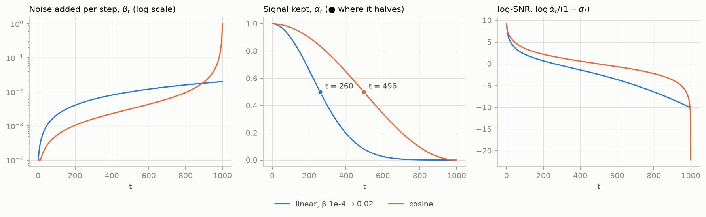
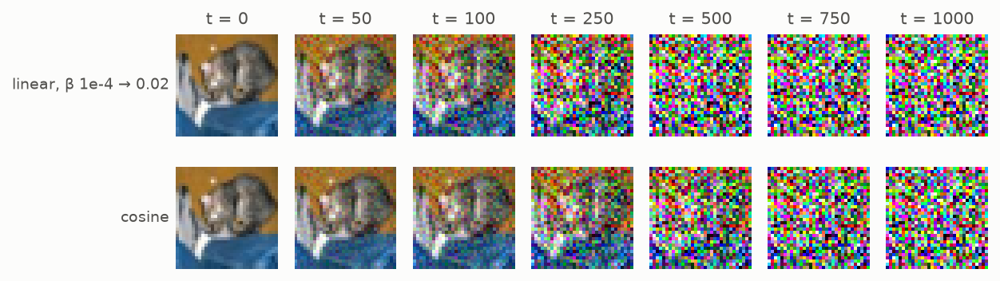
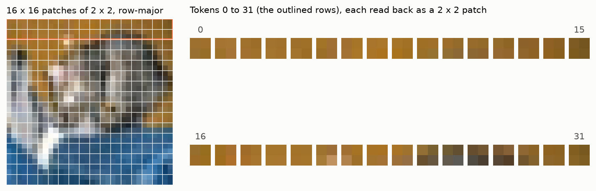
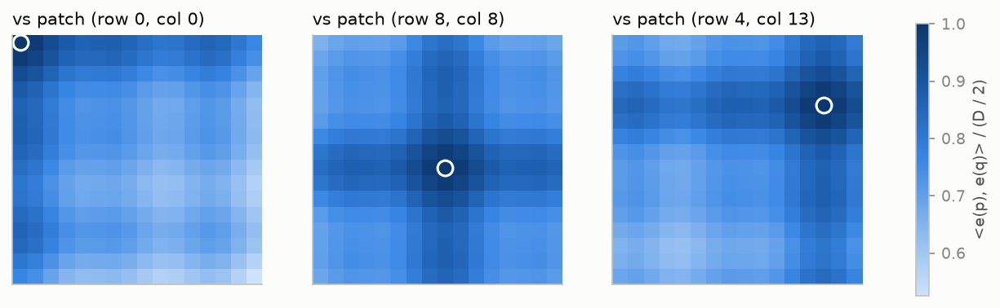
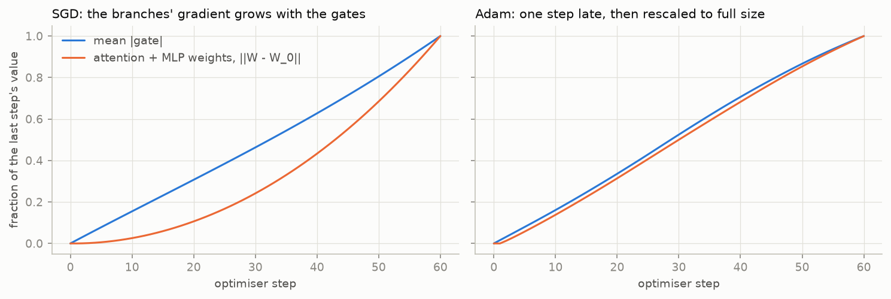

# Architecture

This page covers the models, the training loop, and the math the tests check, with the derivations behind them.

## The denoiser contract

Every model is one function,

$$\varepsilon_\theta(x_t, t, y) \;\to\; \hat\varepsilon,$$

which takes a batch $x_t$ of shape (B, C, H, W) in $[-1, 1]$ and returns the predicted noise in the same shape. $t$ is a long tensor in $[0, T)$: index $i$ is the paper's $t = i + 1$. $y$ is a class label, the null class (index `num_classes`), or `None`.

The samplers see the model only through `predict_noise` in `ddpm/image/diffusion/base.py`. That is also where classifier-free guidance happens, by Ho & Salimans' Eq. 6 with $\omega = 1 + w$:

$$\hat\varepsilon = \varepsilon_\theta(x_t, t, \varnothing) + \omega \left(\varepsilon_\theta(x_t, t, y) - \varepsilon_\theta(x_t, t, \varnothing)\right).$$

Nothing else about the model enters sampling, so the backbone (UNet, DiT) and the sampler (DDPM, DDIM) are independent choices.

## Models

| | UNet ([`configs/image/ddpm.yaml`](../configs/image/ddpm.yaml)) | DiT ([`configs/image/dit.yaml`](../configs/image/dit.yaml)) |
|---|---|---|
| Parameters | 770K | 765K |
| Representation | Feature maps at $32^2$, $16^2$, $8^2$, $4^2$ | 256 tokens, one per $2 \times 2$ patch |
| Width | 32 / 64 / 64 / 64 channels | 64 |
| Depth | 2 residual blocks per stage, down and up, and a bottleneck | 10 transformer blocks |
| Attention | At $16^2$ and in the bottleneck, 2 heads | Every block, 2 heads |
| Conditioning | Scale and shift of every residual block's GroupNorm | adaLN-Zero in every block |
| Position | Implicit in the convolutions | Fixed 2D sin-cos embedding |

Both embed $t$ the same way: the sinusoidal encoding of Ho et al.'s Appendix B, then Linear → SiLU → Linear to a 64-d vector. With guidance on, a learned class embedding with `num_classes + 1` rows, the last one the null class, is added to it.

**UNet** (Ho et al., Appendix B). Deviations:
- A residual block is one convolution, then GroupNorm, a scale and shift from the timestep embedding (AdaGN, Dhariwal & Nichol §3.1), and SiLU, plus a shortcut. DDPM's block has two pre-activation convolutions, and adds the embedding as a bias between them.
- No GroupNorm before attention.
- Downsampling is a $1 \times 1$ stride-2 convolution, upsampling a transposed convolution. DDPM uses a $3 \times 3$ stride-2 convolution, and nearest-neighbour upsampling followed by a $3 \times 3$ convolution.
- One skip connection per stage rather than per block, $1 \times 1$ stem and head convolutions, and a skip from the stem into the head.

**DiT** (Peebles & Xie). The image is cut into $2 \times 2$ patches, each linearly embedded as a token. Each block is attention and an MLP, each gated by adaLN-Zero on the timestep (and class) embedding. A final adaLN layer maps each token back to a $2 \times 2 \times 3$ patch. Deviations: pixel space instead of VAE latents, and only $\varepsilon$ is predicted, not the variance.

## Training

Each step is Ho et al.'s Algorithm 1. Draw $t \sim \mathcal U\{1, \dots, T\}$ and $\varepsilon \sim \mathcal N(0, I)$, form

$$x_t = \sqrt{\bar\alpha_t}\, x_0 + \sqrt{1 - \bar\alpha_t}\, \varepsilon \qquad \text{(Eq. 4)},$$

and minimise $L_\text{simple} = \lVert \varepsilon - \varepsilon_\theta(x_t, t) \rVert^2$ (Eq. 14). The optimiser is Adam at a constant learning rate of $10^{-3}$, with gradient-norm clipping at 1.0 and random horizontal flips.

- **EMA.** After each step, $\theta_\text{EMA} \leftarrow \lambda\, \theta_\text{EMA} + (1 - \lambda)\, \theta$ with $\lambda = 0.999$, over the trainable parameters. Evaluation uses the EMA weights.
- **Classifier-free guidance.** Training drops each label to the null class with probability 0.1 (Ho & Salimans, Alg. 1).
- **Validation loss.** Every 5 epochs, $L_\text{simple}$ on the test split, for both the raw and the EMA weights, with a fixed $(t, \varepsilon)$ drawn from its own RNG, so it doesn't perturb training.
- **Loss per timestep range.** The training loss is also logged per tenth of $[1, T]$. Its mean isn't comparable across schedules, but these ten curves show a schedule that wastes training on near-pure noise ([tuning](tuning.md#appendix-before-the-ladder)).

## Tests and math

The tests check the repo's own math and its asymptotics, not library behaviour. `pytest` runs in seconds on a CPU. `pytest --viz` makes each test also draw what it checks, and `make figures` copies the drawings into `docs/figures/`, so the figures can't drift from the code.

### Schedules run from data to noise

**Claim.** For the linear and cosine schedules at $T = 1000$, every $\beta_t \in (0, 1)$, so

$$\bar\alpha_t = \prod_{s=1}^{t} (1 - \beta_s)$$

falls strictly, from $\bar\alpha_1 \approx 1$ to $\bar\alpha_T \approx 0$. Then $x_T$ keeps under 1% of $x_0$, and $q(x_T) \approx \mathcal N(0, I)$.

**Test.** Checks each of these bounds for both schedules.

**Figure.** $\beta_t$, the noise added per step; $\bar\alpha_t$, the signal kept, with a dot where it halves; and the log signal-to-noise ratio $\log \bar\alpha_t / (1 - \bar\alpha_t)$. Cosine keeps more signal than linear until the last steps.

### The closed form is the marginal of the chain

**Claim.** One forward step is $x_t = \sqrt{\alpha_t}\, x_{t-1} + \sqrt{1 - \alpha_t}\, \varepsilon_t$ (Eq. 2). If $x_{t-1} = \sqrt{\bar\alpha_{t-1}}\, x_0 + \sqrt{1 - \bar\alpha_{t-1}}\, \bar\varepsilon$, then $x_t = \sqrt{\bar\alpha_t}\, x_0$ plus two independent Gaussians whose variances sum to $\alpha_t (1 - \bar\alpha_{t-1}) + 1 - \alpha_t = 1 - \bar\alpha_t$. That is Eq. 4.

**Test.** Runs the chain step by step from one $x_0$, and checks that its per-pixel mean and std match sampling Eq. 4 directly at every $t$. The $\beta_t$ are large, so pairing chain step $t$ with the wrong $\bar\alpha$ fails.

**Figure.** Eq. 4 on a CIFAR-10 image under each schedule, with the same $\varepsilon$ in every row.

### Samplers with the exact denoiser

**Claim.** Take data $x_0 \sim \mathcal N(0, s^2 I)$. Then $x_t$ and $\varepsilon$ are jointly Gaussian, with $\operatorname{Var}(x_t) = v_t = \bar\alpha_t s^2 + 1 - \bar\alpha_t$, and the best denoiser is known in closed form:

$$\varepsilon^\star(x_t) = \mathbb E[\varepsilon \mid x_t] = \frac{\sqrt{1 - \bar\alpha_t}}{v_t}\, x_t.$$

With $\varepsilon^\star$ in place of the network, any error left is the sampler's own.

- **DDPM** keeps the forward marginal's std, $\sqrt{v_t}$, at every step.
- **DDIM** with $\eta = 0$ becomes linear. Write $a_t = (\sqrt{\bar\alpha_t}\, s, \sqrt{1 - \bar\alpha_t})$, so $\lVert a_t \rVert^2 = v_t$, and let $\theta_t$ be $a_t$'s angle. Substituting $\varepsilon^\star$ into Song et al.'s Eq. 12 gives a step from $t$ to $t' < t$ of $x_{t'} = \frac{a_{t'} \cdot a_t}{\lVert a_t \rVert^2}\, x_t$. If $x_t$ has the right std $\lVert a_t \rVert$, then
  $$\operatorname{std}(x_{t'}) = \lVert a_{t'} \rVert \cos(\theta_t - \theta_{t'}) \le \lVert a_{t'} \rVert,$$
  with equality only when $t' = t$ (Cauchy–Schwarz). Each step loses a factor $\cos\Delta\theta$, so few-step DDIM undershoots the data's spread. With $n$ steps, $\prod_k \cos\Delta\theta_k \approx \exp(-\tfrac12 \sum_k \Delta\theta_k^2) = 1 - O(1/n)$, so the shortfall vanishes as $n$ grows.

**Test.** Uses a small $s$, so clipping doesn't fire. DDPM's std at 1000 steps matches $\sqrt{v_t}$ within sampling noise. DDIM's at 10 and 50 steps follows the product of cosines at every step, and ends further below $s$ at 10 steps than at 50.

**Figure.** The std of the input to each model call, and its ratio to $\sqrt{v_t}$. DDIM's ratio starts slightly above 1, because its grid starts at $t = T - T/n$, as in the DDIM reference code, where $\mathcal N(0, I)$ is a little too wide.

### Static thresholding keeps $x_t$

**Claim.** DDPM and DDIM both recover a clean-image estimate (DDIM Eq. 9), $\hat x_0 = (x_t - \sqrt{1 - \bar\alpha_t}\, \hat\varepsilon) / \sqrt{\bar\alpha_t}$, clamp it to $[-1, 1]$ (Saharia et al.'s static thresholding), and back out the matching noise:

$$\tilde\varepsilon = \frac{x_t - \sqrt{\bar\alpha_t}\, \operatorname{clip}(\hat x_0)}{\sqrt{1 - \bar\alpha_t}}.$$

By construction, $\sqrt{\bar\alpha_t}\, \operatorname{clip}(\hat x_0) + \sqrt{1 - \bar\alpha_t}\, \tilde\varepsilon = x_t$.

**Test.** An out-of-range $\hat x_0$ lands on $\pm 1$, an in-range one is unchanged, and the pair still reconstructs $x_t$.

**Figure.** Each pixel's $x_t$ fixes a line in the $(\hat x_0, \varepsilon)$ plane, and clipping moves along it.

### Patches are tokens, row-major

**Claim.** DiT cuts a $32 \times 32$ image into a $16 \times 16$ grid of $2 \times 2$ patches. Token $n$ is the patch at row $\lfloor n / 16 \rfloor$, column $n \bmod 16$, and `unpatchify` reads each token's $p \cdot p \cdot C$ values back as a $(p, p, C)$ patch.

**Test.** Sets the patch embedding to the identity, so that a token is its patch's pixels. Then `unpatchify` must return the input exactly, which holds only if the two layouts agree.

### Sin-cos position embeddings see only offsets

**Claim.** Each half of the 2D embedding encodes one coordinate as $e(p) = [\sin \omega_k p,\ \cos \omega_k p]_k$. Since $\sin a \sin b + \cos a \cos b = \cos(a - b)$,

$$\langle e(p), e(q) \rangle = \sum_k \cos\!\big(\omega_k (p - q)\big),$$

which depends only on the offset $p - q$. The row and column halves add, so two patches' similarity is $f(\Delta\text{row}) + f(\Delta\text{col})$, with its maximum, $D/2$, only at zero offset.

**Test.** Checks the diagonal, that every off-diagonal entry is lower, and that the similarity is constant along each offset.

**Figure.** The similarity to a reference patch: the same cross shape wherever the reference sits.

### adaLN-Zero starts as the identity

**Claim.** A DiT block adds each branch through a gate: $h = x + g_\text{msa} \odot \operatorname{Attn}(\cdot)$, then $h + g_\text{mlp} \odot \operatorname{MLP}(\cdot)$. The gates come from a linear layer initialised to zero, so a fresh block is the identity. The gradient reaching a branch's weights is proportional to its gate, so at initialisation it is exactly zero. The gate layer's gradient is not: $\partial L / \partial g$ is proportional to the branch's output.

**Test.** Checks both gradients at initialisation.

**Figure.** One block trained for 60 steps. With SGD, the branch weights lag the gates, because their gradient grows with the gates. With Adam, the lag is one step: the zero gradient at step 0 gives a zero update, and from step 1 Adam rescales the small gradient to full size.

